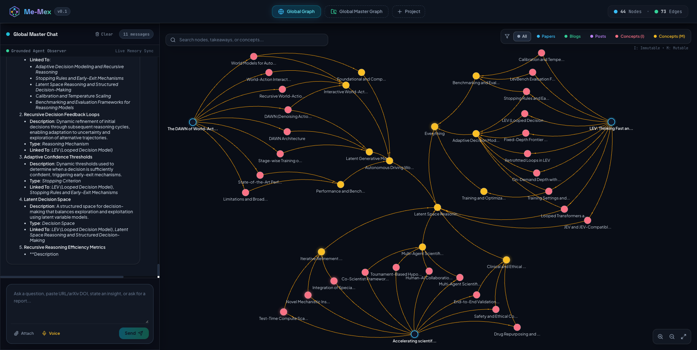

# Me-Mex

> **Agentic Knowledge Graph & External Memory System**

Me-Mex is an agentic external memory and RAG system designed for organizing, linking, and retrieving textual knowledge, including academic research papers, technical blogs, X posts and YouTube video transcripts—without manual note scrolling or cognitive overload.

---

## 📸 Current Status (26/10/26)

The pipeline is working end-to-end for ingestion of an arxiv paper and adding it to the graph with re-organization. The "Everything" concept node is where it all begins followed by sub-division into different concepts as it gets connected to more concepts.



---

## 🚀 Running the App

```bash
# run the backend app (assuming the MongoDB server is already running)
uvicorn main:app --host 0.0.0.0 --port 8000 --reload

# run the frontend
npm run dev
```

---

## 📚 Master Documentation Index

All master technical specs, research syntheses, and product roadmaps are consolidated in the `docs/` directory:

- 🏗️ **[`docs/ARCHITECTURE.md`](./docs/ARCHITECTURE.md)**: Unified technical spec, 3-element topology, Node Mutability Hierarchy, 3-step persona workflows, API endpoints, and WebGL specs.
- 🔬 **[`docs/RESEARCH_SYNTHESIS.md`](./docs/RESEARCH_SYNTHESIS.md)**: Literature surveys on GraphRAG, HippoRAG 2, Stanford STORM, Google Co-Scientist, multi-agent debate frameworks, and deep-dive paper notes.
- 🗺️ **[`docs/ROADMAP.md`](./docs/ROADMAP.md)**: Strategic 5-phase execution roadmap (Backend $\rightarrow$ Testing $\rightarrow$ Frontend $\rightarrow$ End-to-End Interactivity $\rightarrow$ Fine-Tuning & Cortex-OS).

---

## 🏗️ The Operational System Architecture

Graph-Memex operates on a continuous **Conversational Gateway (`POST /api/chat`)** loop unifying **Conversation** (direct response), **Retrieval** (2 pre-steps $\rightarrow$ final conversation), and **Ingestion** (2 pre-steps $\rightarrow$ final conversation):

```
┌────────────────────────────────────────────────────────────────────────────────────────┐
│                        1. Document Ingestion & Staging                                 │
└────────────────────────────────────────────────────────────────────────────────────────┘
 - Universal Source Ingestion:
     - Remote Web URLs: Supports arXiv papers, web blogs, Substack, Medium, and online HTML articles with automatic metadata extraction.
     - Local Filesystem & `file://` URIs: Directly ingests local files (`file:///path/to/doc.pdf`, `/path/to/notes.txt`, `~/docs/guide.md`, `saved_page.html`). Automatically dispatches to format-specialized extractors (PDF parsing, Trafilatura HTML extraction, markdown reader, or auto-titled plain text/notes).
 - Staged Sandbox: Uploaded documents/links do NOT immediately populate the active graph.
 - Scale-Adaptive Document Chunking (1 to 30 Passages):
     - Dynamically partitions documents based on length: <= 1.5k chars (1 chunk for X posts/short notes), 1.5k–4k (2 chunks), 4k–8k (3 chunks), 8k–14k (4 chunks), 14k–25k (5 chunks), and scales smoothly up to 30 chunks (>= 300k chars), bounded by [1, 30].
     - Context Window & Token Budget Protection: Guarantees individual chunks never exceed 45,000 characters (~13,000 tokens), safeguarding Ministral 3-8B's 16,384-token context window against prompt overflow while reserving 1,536 completion tokens.
     - Density-Aware Concept Extraction & Consolidation: Passages extract 1 to 3 concepts (1 for focused notes, 2–3 for rich passages, max 3). Canonical consolidation scales naturally without forcing an arbitrary 6–10 concept quota for low-volume documents.
 - Out-of-Graph Passage Storage: Text chunks are stored as plain text records in `passages`
   collection, linked only via `passage_ids` inside atomic `CONCEPT` nodes.
 - Plain text retrieval: Passages are opened only when clicked to validate concept extraction.

┌────────────────────────────────────────────────────────────────────────────────────────┐
│                       2. Memory Storage & Topology                                     │
└────────────────────────────────────────────────────────────────────────────────────────┘
 - Universal Genesis Concept Node (`concept_genesis` / "Everything"):
     - Primordial universal mutable knowledge anchor seeded in every empty workspace.
     - Guarantees cold-start hub availability: on first ingestion, "Persona Specialist: Everything" acts as the initial hub. Subsequent concepts attach to it and subdivide via `SPLIT_CONCEPT` as degree grows.
 - Strict Hub Criteria:
     - Root nodes and Immutable Concept nodes are **100% excluded** from candidate hubs.
     - Full graph topology (including immutable evidence edges) contributes to centrality calculation, but candidate hubs are strictly mutable concept nodes (`k <= 5`, $s_i \ge 0.3 \times s_{\max}$).
 - Zero Passage Clutter: Passages are NOT graph nodes. The active network contains:
     1. ROOT Nodes (Immutable)            : Base node for a paper, blog, transcript, or X post, shortly summarizing everything in that document.
     2. CONCEPT Nodes                     : Self-evolving atomic concepts.
        - Intra-Document Concepts (Immutable) : Factual concepts extracted directly from document text.
        - Domain & Intermediate Nodes (Mutable): Persona-created domain hub & bridge concepts.
     3. QUALITATIVE RELATION EDGES        : Typed structural edges (`SUBSET_OF`, `SUPERSET_OF`, `RELEVANT_TO`, `BUILDS_UPON`, `SUPERSEDES`, `PARALLEL_TO`, `CONTRASTS_WITH`) with contextual edge descriptions.
 - Local Raw Markdown Archive: Extracted documents automatically archive their full raw markdown to `backend/temp_downloads/` with metadata headers for inspection.
 - Comprehensive Telemetry: Real-time lifecycle events emitted for document fetching, chunking, extraction progress, consolidation, root creation, intra-concept creation, hub calculation, and partitioning.
 - First-Class Timestamps: Nodes and edges carry explicit creation/update timestamps (`created_at`, `updated_at`), enabling persona agents to reason about temporal progression and historical context naturally. Optional frontend toggles visualize timeline progression using color-coded time windows.

┌────────────────────────────────────────────────────────────────────────────────────────┐
│             3. Mutually Exclusive Concept Hub Exploration & Relevance Evaluation       │
└────────────────────────────────────────────────────────────────────────────────────────┘
 - Unweighted Topological Hub Discovery: Foundational concept hubs are detected in real time (<5ms) via `rustworkx` unweighted eigenvector centrality with relative thresholding ($s_i \ge 0.30 \times s_{\max}$). Each detected concept hub is assigned a dedicated Specialist Persona representing domain expertise for that concept cluster.
 - Mutually Exclusive Voronoi Sub-Graph Partitioning: Rather than unanchored graph clustering, the graph network is partitioned via multi-source topological shortest-path (Voronoi) distance anchored directly to the detected concept hubs. Every node in the graph is assigned to its closest department hub (with ties broken by hub centrality), strictly guaranteeing non-empty, non-overlapping partitions ($P_i \cap P_j = \emptyset$). Each Specialist Persona independently explores its strictly assigned sub-graph partition (`explore_concept_hub`) up to `max_depth = 3`.
 - Relevance Evaluation & Independent Operation: Because all intra-document concept nodes are completely immutable, proposals from different personas operate on disjoint/immutable nodes without conflicts.
 - Real-Time SSE Telemetry: Streams live persona traversal events (`traversed_node_ids`) to animate the WebGL canvas (`react-force-graph-2d`).

┌────────────────────────────────────────────────────────────────────────────────────────┐
│                      4. Agentic Tool Ingestion & Multi-Hub Integration                 │
└────────────────────────────────────────────────────────────────────────────────────────┘
 - Tool-Based Fetching & Construction: Executive Orchestrator calls `ingest_document_tool` when URLs/PDFs are pasted, storing text chunks in `passages` and building intra-document concept nodes.
 - Sub-Graph Traversal & Relevance Evaluation: Performs partitioned sub-graph traversal and relevance evaluation across concept hubs to determine optimal attachment points.
 - Priority Immutable-First Outward Reorganization: Macro node reorganization (`SPLIT_CONCEPT` / `reorganize_concept_hub`) executes a priority immutable-first outward movement loop:
     1. Candidate Screening: Evaluates high-degree hubs against dynamic threshold $\tau = \max(3, \lfloor \text{p75}(\text{degrees}) \rfloor)$ and generates candidate rationales.
     2. Immutable Leaves Outward Absorption:
        - If immutable leaves exist, clusters them into $k_{new} \ll |N_{immutable}|$ intermediate abstractions. In mixed mode, existing mutable concepts serve as negative exclusion context.
        - Dynamic Degree Re-evaluation: Hub degree is recalculated ($\text{deg}'(H) = |N_{mut}| + k_{new}$). If $\text{deg}'(H) < \tau$, the hub has decongested and finishes. If still $\ge \tau$, the new sub-concepts join the mutable set.
     3. Pure Mutable Outward Partition:
        - Single execution path partitioning mutable concepts (whether originally pure mutable or a mixed hub that required further splitting).
     4. Non-Destructive Invariant: The parent hub is always preserved as the umbrella concept anchoring the tree.
 - Local LLM Telemetry Tracing: All LLM interactions (prompts, completions, parsed JSON, token latencies, and caller metadata) are logged locally to `backend/logs/llm_traces/runs/<date>/<session>/` via `LLMTracer`.
```

---

## 🛠️ Technology Stack & Engine Architecture

* **Database Engine:** **MongoDB** document database (`documents`, `passages`, `nodes`, `edges`, `macro_documents`, `staging_sandbox`, `projects`, `chat_messages`) with in-memory fallback for local execution.
* **LLM Gateway:** **Ministral 3-8B** running remotely via Colab vLLM server (`http://localhost:8000/v1`) with local rule-based fallback.
* **Graph Analytics Worker:** **`rustworkx`** PyDiGraph for fast (<1ms) eigenvector/degree Hub Centrality ranking with dynamic node-type filtering and relative score thresholding.
* **Agent Protocol & Tools:** **FastMCP** (Python MCP SDK) exposing typed tools (`search_duckduckgo_web`, `search_arxiv_papers`, `fetch_web_article`, `get_graph_nodes`, `get_passages_by_ids`, `get_macro_documents`, `calculate_hub_rankings`).
* **Search Integrations:** **`arxiv`** API client and **`trafilatura`** web page markdown extractor.
* **Telemetry & Response Streaming:** **FastAPI + SSE Starlette** streaming real-time token chunks and persona node traversal events to the client.
* **Speech-to-Text (STT) Dictation:** **Whisper-Base.en** (`@xenova/transformers`) running 100% locally in the browser via WebAssembly/WebGPU. Users dictate voice notes directly into the chat input box to review and edit before sending.
* **Frontend Visualization:** **React + WebGL** (`react-force-graph-2d`), featuring off-canvas Markdown drawers and visual node highlights.

---

## 🚀 Backend Implementation

- **`app/db.py`**: MongoDB Database Engine with models for Documents, Passages, Graph Nodes, Connection Edges, Project Workspaces, Chat Messages, and Staging Records.
- **`app/services/llm_gateway.py`**: vLLM gateway client targeting Colab Ministral 3-8B with local rule-based fallback.
- **`app/services/prompt_mapper.py`**: Dual-cache ID mapping boundary (`PromptIdMapper`) providing bidirectional translation between canonical MongoDB string IDs and 1-based integer indices for prompt isolation.
- **`app/services/graph_analytics.py`**: `rustworkx` Hub Centrality worker with pure centrality dynamic thresholding and project-scoped graph filtering.
- **`app/tools/search_tools.py`**: ArXiv research paper search and Trafilatura web article text extractor.
- **`app/agents/department_persona.py`**: Specialist Personas for shared sub-graph exploration (`explore_concept_hub`), retrieval synthesis (`explore_and_retrieve`), and structured graph ingestion (`persona_ingestion`).
- **`app/agents/orchestrator.py`**: Executive Orchestrator coordinating Direct Conversation, Ingestion, and Persona Retrieval flows with `chat_history` context-aware intent classification.
- **`app/api/sse.py`**: FastAPI SSE endpoint (`/api/sse/chat`) streaming live persona traversal telemetry.
- **`main.py`**: REST API endpoints for unified chat (`POST /api/chat`), project workspaces (`GET/POST /api/projects`), project chat history (`GET /api/projects/{id}/chat`), and graph querying (`GET /api/graph?project_id=...`).
- **`tests/`**: Pytest test suite with `-n 2` parallel worker isolation, passing all database, project scoping, analytics, retrieval stream, concept merging, and API checks.

---

## 🧪 Running Backend Unit & Integration Tests

Run the test suite using the project virtualenv via `pytest` (pre-configured in `backend/pytest.ini` with 2 parallel workers and worker-isolated databases):

```bash
# Navigate to the backend directory
cd me-mex/backend

# Run full backend test suite via pytest
python -m pytest tests

# Run specific test modules or targeted paths:
python -m pytest tests/test_search_tools.py
python -m pytest tests/test_e2e_workflows.py -k "test_e2e_ingestion_workflow_real_paper"
```
