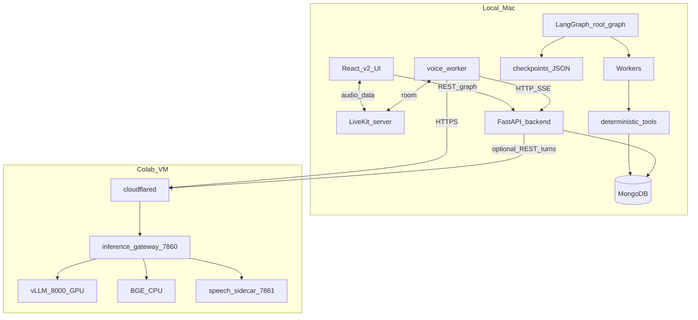

# Me-Mex (v2)

**Me-Mex** is a voice-first **external memory** for research: a MongoDB knowledge graph, LangGraph agents, and human-in-the-loop approvals—so you can gist papers, deep-read into concepts, link ROOTs to hubs, and reorganize topology **without** silent auto-ingest.

The monolithic v1 stack (orchestrator ingest, `/api/chat`) is preserved only on git tag **`v1`** — see [docs/01-v1-baseline.md](./docs/01-v1-baseline.md).

---

## What this repo is (and is not)

| In scope on `main` | Not on `main` / not yet complete |
|--------------------|---------------------------------|
| Workflow-driven writes + explicit approval | URL → auto ingest + link + reorg |
| Deterministic tools + LangGraph workers | v1 `ExecutiveOrchestrator` |
| Headless REST + interactive voice/dock MVP (LiveKit, canvas, HITL) | Formal Phase 2 exit: manual demo sign-off and full voice-workflow parity |
| Agents call live `get_chains()` / `get_decision_scorer()` per `backend/.env.test` | Colab gateway required for default pytest; `-m vllm` adds decision/score integration |

Canon: **[`docs/`](./docs/)** — [docs/README.md](./docs/README.md), [docs/09-phasing.md](./docs/09-phasing.md), [docs/11-testing.md](./docs/11-testing.md).

**Decision routing (spec):** off-the-shelf **cross-encoder reranker** on the Colab **inference gateway** (`POST /v1/decision/score`)—not LoRA on Ministral. See [docs/05-models-and-runtime.md](./docs/05-models-and-runtime.md).

---

## Prerequisites

- **Python 3.11+**, **[uv](https://docs.astral.sh/uv/)**
- **MongoDB** on `localhost:27017` (`me-mex` dev, `test-me-mex` tests)

---

## Quick start

```bash
cd me-mex
uv sync
./scripts/install-git-hooks.sh   # optional: ruff format/check on every commit
```

`backend/.env` (see `backend/.env.example`):

```env
MONGO_URI=mongodb://localhost:27017
DB_NAME=me-mex
```

```bash
uv run uvicorn main:app --app-dir backend --host 0.0.0.0 --port 8000 --reload
# Optional: bootstrap JSONL for reranker eval / future fine-tune
cd backend && uv run python -m app.bootstrap.notes_to_jsonl
cd backend && uv run python -m app.bootstrap.split_train_eval data/decision_training/robotics/bootstrap.jsonl --out-dir data/decision_training/robotics
```

Example:

```bash
curl -X POST 'http://localhost:8000/api/projects?name=Demo'
curl -X POST http://localhost:8000/api/agent/turn \
  -H 'Content-Type: application/json' \
  -d '{"text":"hello","thread_id":"t1","context_json":{"active_project_id":"<project_id>"}}'
```

---

## Testing

Requires **MongoDB** on `localhost:27017` and a reachable **`COLAB_INFERENCE_BASE_URL`** in committed **`backend/.env.test`** (`CHAT_LLM_MODE=live`, `DECISION_SCORER_MODE=live`). Pytest sets `TESTING=1` and loads that file—no conftest override to stub/mock.

From repo root (`me-mex/`):

```bash
# Default gate — honors backend/.env.test (live chat + live decision scorer where used)
uv run pytest

# Extra gateway suites (still uses .env.test)
uv run pytest backend/tests/integration/decision -m vllm -n 0

# Optional: chat/score eval script (see backend/data/decision_training/README.md)
uv run python backend/scripts/eval_decision_model.py --live

# Frontend (dock / voice helpers)
cd frontend && npm install && npm test
```

Manual tunnel smoke (replace with your `trycloudflare` host):

```bash
curl -sS "https://YOUR_HOST.trycloudflare.com/health"
curl -sS -X POST "https://YOUR_HOST.trycloudflare.com/tts/synthesize" \
  -H 'Content-Type: application/json' -d '{"text":"ok"}' -o /tmp/tts.wav
```

Marker details: [docs/11-testing.md](./docs/11-testing.md), `backend/pytest.ini`.

---

## Layout

```
me-mex/
  docs/                 # product & engineering spec
  backend/
    app/
      agents/           # LangGraph supervisor + workers
      tools/            # deterministic graph tools + search_tools
      db/               # Store / Mongo
      api/              # FastAPI routes
      bootstrap/        # notes → JSONL
      services/         # llm_gateway, decision_scorer, checkpoints, …
    tests/              # unit, integration, e2e
  frontend/             # voice rail + recommendations dock + canvas
  voice_worker/         # LiveKit voice process (package voice_agent)
  colab/                # gateway, vLLM, speech, training scripts
```

**Naming:**

| Path / API | Meaning |
|------------|---------|
| `voice_worker/` + `voice_agent` | Separate **LiveKit** process (mic, STT/TTS, room data channel) |
| `backend/app/agents/` | **LangGraph** orchestration inside FastAPI |
| `/api/agent/*` | REST **agent turn** API (not the LiveKit package name) |

---

## Phase 2 runtime topology

WebRTC stays **local**; model weights stay on **Colab** (same `trycloudflare` host as Phase 1).



| Env | Example |
|-----|---------|
| `COLAB_INFERENCE_BASE_URL` | `https://YOUR_HOST.trycloudflare.com` (chat `/v1/…`, speech `/stt` `/tts` on same host) |

---

## Local dev stack (Phase 2)

1. **MongoDB** — `mongodb://localhost:27017` (dev `me-mex`, tests `test-me-mex` or per-xdist `test-me-mex-gw0`). Full dev wipe (graph, dock, session checkpoints, trace logs → global + genesis only): `./scripts/reset-workspace.sh -y` then restart backend and voice_worker.
2. **Colab** — [colab/RUNBOOK.md](./colab/RUNBOOK.md) tmux stack (vLLM + gateway + speech + tunnel).
3. **Backend** — `uv run uvicorn main:app --app-dir backend --reload --port 8000`
4. **LiveKit server (Docker, local SFU):**

```bash
docker run --rm -p 7880:7880 -p 7881:7881 -p 7882:7882/udp \
  -e LIVEKIT_KEYS="devkey: secret" \
  livekit/livekit-server --dev
```

Set in gitignored `backend/.env`: `LIVEKIT_URL=ws://localhost:7880`, `LIVEKIT_API_KEY=devkey`, `LIVEKIT_API_SECRET=secret`, plus Colab URLs.

5. **Voice worker** — from repo root (same venv as backend): `PYTHONPATH=backend:voice_worker uv run python -m voice_agent.worker dev` (or `./scripts/dev-stack.sh`)

6. **Frontend** — `cd frontend && npm install && npm run dev` (`VITE_API_BASE_URL=http://127.0.0.1:8000`).

**Voice path:** browser ↔ local LiveKit ↔ `voice_agent` worker ↔ Colab STT/TTS + backend `/api/voice/conversation/stream` (and optional worker dispatch).

**Verify:** `curl http://localhost:8000/api/livekit/token -X POST -H 'Content-Type: application/json' -d '{"room":"me-mex","identity":"dev"}'`

**Voice VAD** (local Silero on the voice worker): default `VOICE_VAD=silero`; optional `VOICE_MIN_SILENCE_MS` (550), `VOICE_MIN_UTTERANCE_MS`, `VOICE_MAX_UTTERANCE_MS`. Legacy RMS: `VOICE_VAD=rms` — see [voice_worker/.env.example](./voice_worker/.env.example).

**Voice E2E smoke** (one sentence, stay connected ~60s after you stop speaking):

| Check | Where |
|-------|--------|
| `STT utterance (Xs, …)` with X ≥ ~2 and sensible text | `.dev-stack/logs/voice_worker.log` |
| `voice_turn reply_len=…` and no `voice_turn failed` / `TTS failed` | `voice_worker.log` |
| `POST /api/voice/conversation/stream` with no trailing ASGI `ERROR` | `backend.log` |
| `POST /stt/transcribe` 200 | Colab `speech.log` / `gateway.log` |
| `POST /v1/chat/completions` 200 | Colab `gateway.log` / `vllm.log` |
| `POST /tts/synthesize` 200 (if TTS enabled) | Colab `speech.log` / `gateway.log` |

---

## API

All agent and graph endpoints live under **`/api/*`** (`/api/projects`, `/api/agent/turn`, `/api/agent/resume`, …). Details: [docs/04-agent-orchestration.md](./docs/04-agent-orchestration.md).

---

## Decision bootstrap and Colab

- **Spec:** [docs/05-models-and-runtime.md](./docs/05-models-and-runtime.md), [reports/2026-11-18-retrieval-methods.md](./reports/2026-11-18-retrieval-methods.md)
- **JSONL:** `app/bootstrap/`, [backend/data/decision_training/README.md](./backend/data/decision_training/README.md)
- **Colab:** [colab/TOPOLOGY.md](./colab/TOPOLOGY.md), [colab/RUNBOOK.md](./colab/RUNBOOK.md), [colab/me_mex_inference_stack.ipynb](./colab/me_mex_inference_stack.ipynb)

```bash
uv run python backend/scripts/eval_decision_model.py --dry-run
# With gateway up: DECISION_SCORER_MODE=live uv run python backend/scripts/eval_decision_model.py --live
```
