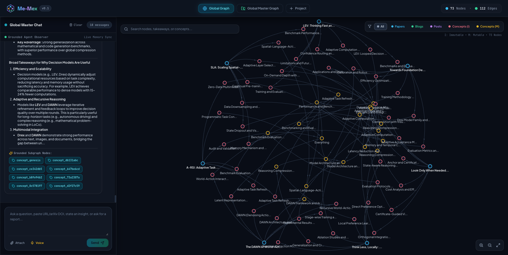
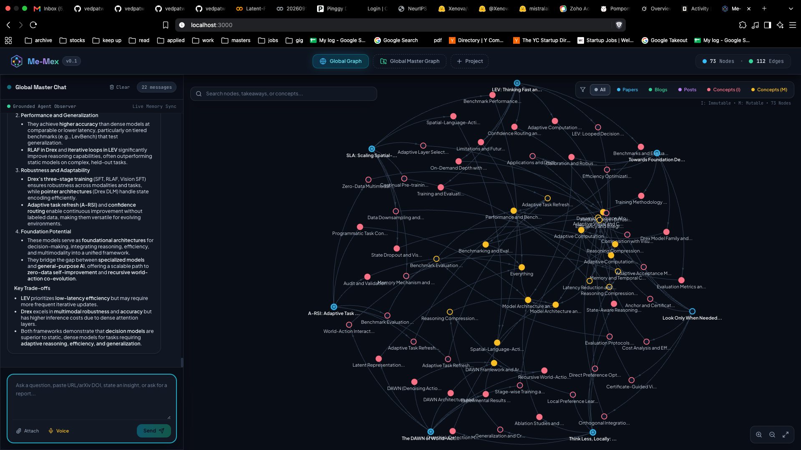

# Me-Mex

> **Agentic Knowledge Graph & External Memory System**

Me-Mex is an agentic external memory and RAG system designed for organizing, linking, and retrieving textual knowledge, including academic research papers, technical blogs, X posts and YouTube video transcripts—without manual note scrolling or cognitive overload.

---

## 📸 Current Status (09/11/26)

The pipeline is working end-to-end for multi-format knowledge ingestion, sub-graph exploration with mutability boundaries, dynamic concept generalization, and scale-aware reorganization. Here's a snapshot of the graph after ingesting 7 research papers across world models, decision models, diffusion and RSI.



---

This graph is then iterated on to fetch concepts relevant to a particular query and highlighted, here's an image for the same:



---

## 🚀 Running the App

```bash
# run the backend app (assuming the MongoDB server is already running)
uvicorn main:app --host 0.0.0.0 --port 8000 --reload

# run the frontend
npm run dev
```

---

## 📚 Master Documentation Index

All master technical specs, research syntheses, and product roadmaps are consolidated in the `docs/` directory:

- 🏗️ **[`docs/ARCHITECTURE.md`](./docs/ARCHITECTURE.md)**: Unified technical spec, 3-element topology, Node Mutability Hierarchy, 3-step persona workflows, API endpoints, and WebGL specs.
- 🔬 **[`docs/RESEARCH_SYNTHESIS.md`](./docs/RESEARCH_SYNTHESIS.md)**: Literature surveys on GraphRAG, HippoRAG 2, Stanford STORM, Google Co-Scientist, multi-agent debate frameworks, and deep-dive paper notes.
- 🗺️ **[`docs/ROADMAP.md`](./docs/ROADMAP.md)**: Strategic 5-phase execution roadmap (Backend $\rightarrow$ Testing $\rightarrow$ Frontend $\rightarrow$ End-to-End Interactivity $\rightarrow$ Fine-Tuning & Cortex-OS).

---

## 🏗️ The Operational System Architecture

Graph-Memex operates on a continuous **Conversational Gateway (`POST /api/chat`)** loop unifying **Conversation** (direct response), **Retrieval** (2 pre-steps $\rightarrow$ final conversation), and **Ingestion** (2 pre-steps $\rightarrow$ final conversation):

```
┌────────────────────────────────────────────────────────────────────────────────────────┐
│                        1. Document Ingestion & Staging                                 │
└────────────────────────────────────────────────────────────────────────────────────────┘
 - Universal Source Ingestion:
     - Remote Web URLs: Supports arXiv papers, web blogs, Substack, Medium, and online HTML articles with automatic metadata extraction.
     - Local Filesystem & `file://` URIs: Directly ingests local files (`file:///path/to/doc.pdf`, `/path/to/notes.txt`, `~/docs/guide.md`, `saved_page.html`). Automatically dispatches to format-specialized extractors (PDF parsing, Trafilatura HTML extraction, markdown reader, or auto-titled plain text/notes).
 - Staged Sandbox: Uploaded documents/links do NOT immediately populate the active graph.
 - Context-Saturated Document Chunking (1 to 30 Passages):
     - Minimizes LLM extract calls: packs each passage up to the vLLM input budget (Colab `--max-model-len 12288`; default ~24k chars per passage after completion/prompt reserve), splitting only when necessary; cap 30 chunks for very large (>= 300k char) documents.
     - Density-Aware Concept Extraction & Scale-Aware Consolidation: Passages extract 1 to 3 concepts (1 for focused notes, 2–3 for rich passages, max 3). Standard documents (> 6 raw concepts) consolidate into **3 to 5 canonical concepts**; concise documents or notes (<= 6 raw concepts) consolidate into **1 to 3 canonical concepts**.
 - Out-of-Graph Passage Storage: Text chunks are stored as plain text records in `passages`
   collection, linked only via `passage_ids` inside atomic `CONCEPT` nodes.
 - Plain text retrieval: Passages are opened only when clicked to validate concept extraction.

┌────────────────────────────────────────────────────────────────────────────────────────┐
│                       2. Memory Storage & Topology                                     │
└────────────────────────────────────────────────────────────────────────────────────────┘
 - Universal Genesis Concept Node (`concept_genesis` / "Everything"):
     - Primordial universal mutable knowledge anchor seeded in every empty workspace.
     - Guarantees cold-start hub availability: on first ingestion, "Persona Specialist: Everything" acts as the initial hub. Subsequent concepts attach to it and subdivide via `SPLIT_CONCEPT` as degree grows.
 - Strict Hub Criteria:
     - Root nodes and Immutable Concept nodes are **100% excluded** from candidate hubs.
     - Full graph topology (including immutable evidence edges) contributes to centrality calculation, but candidate hubs are strictly mutable concept nodes (`k <= 5`, $s_i \ge 0.3 \times s_{\max}$).
 - Zero Passage Clutter: Passages are NOT graph nodes. The active network contains:
     1. ROOT Nodes (Immutable)            : Base node for a paper, blog, transcript, or X post, shortly summarizing everything in that document.
     2. CONCEPT Nodes                     : Self-evolving atomic concepts.
        - Intra-Document Concepts (Immutable) : Factual concepts extracted directly from document text.
        - Domain & Intermediate Nodes (Mutable): Persona-created domain hub & bridge concepts.
     3. QUALITATIVE RELATION EDGES        : Typed structural edges (`SUBSET_OF`, `SUPERSET_OF`, `RELEVANT_TO`, `BUILDS_UPON`, `SUPERSEDES`, `PARALLEL_TO`, `CONTRASTS_WITH`) with contextual edge descriptions.
 - Local Raw Markdown Archive: Extracted documents automatically archive their full raw markdown to `backend/temp_downloads/` with metadata headers for inspection.
 - Comprehensive Telemetry: Real-time lifecycle events emitted for document fetching, chunking, extraction progress, consolidation, root creation, intra-concept creation, hub calculation, and partitioning.
 - First-Class Timestamps: Nodes and edges carry explicit creation/update timestamps (`created_at`, `updated_at`), enabling persona agents to reason about temporal progression and historical context naturally. Optional frontend toggles visualize timeline progression using color-coded time windows.

┌────────────────────────────────────────────────────────────────────────────────────────┐
│             3. Genesis Tree Traversal (Ingestion & Retrieval)                          │
└────────────────────────────────────────────────────────────────────────────────────────┘
 - **Graph Navigator** (`app/agents/graph_navigator.py`) performs top-down traversal from the primordial `concept_genesis` node over the mutable tree backbone (`SUBSET_OF` child→parent edges), guided by the Genesis project description.
 - Immutable leaves appear as read-only context; traversal expands only through mutable children up to `MAX_TRAVERSAL_DEPTH` (default 4).
 - Mutability Exploration Frontier Boundary: Candidate neighbors explicitly include immutable flags. Immutable evidence leaves serve as read-only grounding context to inform personas of existing literature, but personas are strictly barred from expanding hop frontiers from immutable nodes (`if candidate_neighbors[idx]["immutable"]: continue`).
 - Structured Exploration Rationales: Personas emit explicit per-node reasoning (`SelectedNeighborItem` with `rationale`) for each chosen neighbor, streamed over telemetry.
 - Relevance Evaluation & Independent Operation: Because all intra-document concept nodes are completely immutable, proposals from different personas operate on disjoint/immutable nodes without conflicts.
 - Real-Time SSE Telemetry: Streams live persona traversal events (`traversed_node_ids`) to animate the WebGL canvas (`react-force-graph-2d`).

┌────────────────────────────────────────────────────────────────────────────────────────┐
│                      4. Agentic Tool Ingestion, Generalization & Reorganization        │
└────────────────────────────────────────────────────────────────────────────────────────┘
 - Tool-Based Fetching & Construction: Executive Orchestrator calls `ingest_document_tool` when URLs/PDFs are pasted, storing text chunks in `passages` and building intra-document concept nodes.
 - **User-facing ingestion close-out:** After ingest, chat confirms success and lists main canonical concepts only (no edge/linking/timing narration). Tune via `INGESTION_SUMMARY_MAX_TOKENS`, `CONSOLIDATION_MAX_TOKENS`, `CHAT_COMPLETION_MAX_TOKENS` in backend `.env`.
 - **Ingest LLM speed defaults** (in `backend/app/config.py`, override via `.env`): `REORG_PARTITION_MAX_TOKENS` (3072), `COLLECTIVE_LINKING_MAX_TOKENS` (2048), `SUBGRAPH_EXPANSION_MAX_TOKENS` (512), `GENERALIZATION_MAX_TOKENS` (1536); ingest traversal defaults to depth **3** and `INGEST_TRAVERSAL_TOP_K` **1** when unset.
 - Sub-Graph Traversal & Collective Linking: Performs partitioned sub-graph traversal and relevance evaluation across concept hubs to link intra-document concepts to existing mutable domain concepts.
 - Phase 3.5 Targeted Concept Generalization: Dedicated LLM pass isolating all mutable concept nodes that received new connections during ingestion. Synthesizes an updated umbrella title and description to expand their conceptual scope before any reorganization triggers. (The primordial genesis node 'Everything' has its description updated while its title is strictly preserved).
 - **Engine-dispatch reorganization** (`SPLIT_CONCEPT`): LLM proposes clusters; the engine commits **wrapper expansion** only at Genesis and **lateral sibling splits** for all other mutable hubs (`graph_ingestion_engine.py`). Strahler/subtree-height gates protect deep subtrees; health metrics emit via `MutableTreeIndex`.
 - Legacy immutable-first reorganization loop (pre-v0.2 reference):
     1. Candidate Screening & Discovery: Evaluates high-degree hubs against dynamic threshold $\tau = \max(3, \lfloor \text{p75}(\text{degrees}) \rfloor)$ and emits structured candidate rationales.
     2. Scenario-Aware Sub-Concept Formulation (Strict $n // 2$ Compression Invariant):
        - Formulation is strictly capped at $\max(1, \lfloor n / 2 \rfloor)$ sub-concepts across Purely Mutable, Purely Immutable, and Mixed modes.
        - Special Case: $n = 1$ immutable leaf in outward mode formulates exactly 1 intermediate sub-concept.
        - Compulsory Parent Hub Updates: Every `SPLIT_CONCEPT` payload mandates updated `hub_title` and `hub_description` reflecting the parent hub's new umbrella role over the synthesized sub-concepts.
     3. Immutable Leaves Outward Absorption (Mixed Mode):
        - Clusters raw immutable leaves outward into $k_{new} \le \lfloor |N_{imm}| / 2 \rfloor$ intermediate abstractions.
        - Dynamic Degree Re-evaluation: Hub degree is recalculated ($\text{deg}'(H) = |N_{mut}| + k_{new}$). If $\text{deg}'(H) < \tau$, the hub has decongested and finishes. If still $\ge \tau$, the new sub-concepts join the mutable set for the second split.
     4. Pure Mutable Outward Partition:
        - Single execution path partitioning mutable concepts (whether originally pure mutable or a mixed hub that required further splitting).
     5. Non-Destructive Invariant: The parent hub is always preserved as the umbrella concept anchoring the tree.
 - Local LLM Telemetry Tracing: All LLM interactions (prompts, completions, parsed JSON, token latencies, and caller metadata) are logged locally to `backend/logs/llm_traces/runs/<date>/<session>/` via `LLMTracer`.
```

---

## 🛠️ Technology Stack & Engine Architecture

* **Database Engine:** **MongoDB** document database (`documents`, `passages`, `nodes`, `edges`, `projects`, `chat_messages`) with in-memory fallback for local execution.
* **LLM Gateway:** **Ministral 3-8B** running remotely via Colab vLLM server (`http://localhost:8000/v1`) with local rule-based fallback.
* **Graph Analytics Worker:** **`MutableTreeIndex`** (depth, Strahler, Sackin, K-hop reachability) plus **`rustworkx`** PyDiGraph construction.
* **Agent Protocol & Tools:** **FastMCP** (Python MCP SDK) exposing typed tools (`search_duckduckgo_web`, `search_arxiv_papers`, `fetch_web_article`, `get_graph_nodes`, `get_passages_by_ids`, `get_macro_documents`, `calculate_hub_rankings`).
* **Search Integrations:** **`arxiv`** API client and **`trafilatura`** web page markdown extractor.
* **Telemetry & Response Streaming:** **FastAPI + SSE Starlette** streaming real-time token chunks and persona node traversal events to the client.
* **Speech-to-Text (STT) Dictation:** **Whisper-Base.en** (`@xenova/transformers`) running 100% locally in the browser via WebAssembly/WebGPU. Users dictate voice notes directly into the chat input box to review and edit before sending.
* **Frontend Visualization:** **React + WebGL** (`react-force-graph-2d`), featuring a streamlined slide-out **Description** panel, normalized single-badge headers, canvas search over node descriptions, and real-time persona traversal glowing.

---

## 🚀 Backend Implementation

- **`app/db.py`**: MongoDB Database Engine with models for Documents, Passages, Graph Nodes, Connection Edges, Project Workspaces, Chat Messages, and Staging Records.
- **`app/services/llm_gateway.py`**: vLLM gateway client targeting Colab Ministral 3-8B with local rule-based fallback.
- **`app/services/prompt_mapper.py`**: Dual-cache ID mapping boundary (`PromptIdMapper`) providing bidirectional translation between canonical MongoDB string IDs and 1-based integer indices for prompt isolation.
- **`app/services/graph_analytics.py`**: `MutableTreeIndex` (depth, Strahler, Sackin, reachability) and `rustworkx` graph construction.
- **`app/tools/search_tools.py`**: ArXiv research paper search and Trafilatura web article text extractor.
- **`app/agents/graph_navigator.py`**: Genesis-rooted tree traversal, linking (`link_intradoc_concepts`), and reorganization (`reorganize_overclustered_nodes`, `build_split_command_for_hub`).
- **`app/services/reorg_rewire_utils.py`**: Reorg rewire neighbor closure and SUBSET_OF-safe relation resolution.
- **`app/services/reorg_queue.py`**: Phase 4 hybrid FIFO/FILO work queue and sibling deferral before parent cascade.
- **`app/agents/orchestrator.py`**: Executive Orchestrator coordinating Direct Conversation, Ingestion, and Genesis tree retrieval with `chat_history` context-aware intent classification.
- **`app/api/sse.py`**: FastAPI SSE endpoint (`/api/sse/chat`) streaming live graph traversal telemetry.
- **`main.py`**: REST API endpoints for unified chat (`POST /api/chat`), project workspaces (`GET/POST /api/projects`), project chat history (`GET /api/projects/{id}/chat`), and graph querying (`GET /api/graph?project_id=...`).
- **`tests/`**: Pytest test suite with `-n 2` parallel worker isolation, passing all database, project scoping, analytics, retrieval stream, concept merging, and API checks.

---

## 🧪 Running Backend Unit & Integration Tests

Run the test suite using the project virtualenv via `pytest` (pre-configured in `backend/pytest.ini` with 2 parallel workers and worker-isolated databases):

```bash
# Navigate to the backend directory
cd me-mex/backend

# Run full backend test suite via pytest
python -m pytest tests

# Run specific test modules or targeted paths:
python -m pytest tests/test_search_tools.py
python -m pytest tests/test_e2e_workflows.py -k "test_e2e_ingestion_workflow_real_paper"

# Tests that call the live Ministral vLLM endpoint (COLAB_VLLM_URL in backend/.env.test)
../.venv/bin/pytest -m vllm

# Offline / CI without a tunnel — skip only vLLM-marked tests:
SKIP_LLM=1 ../.venv/bin/pytest
```
