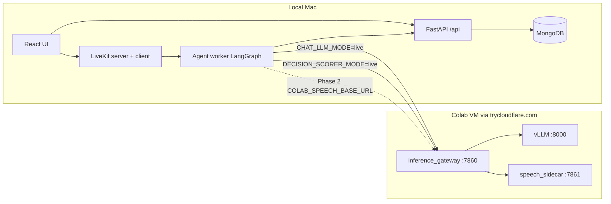

# Me-Mex Colab inference topology (L4)

This document describes how **four remote capabilities** — chat LLM, LoRA decision, STT, TTS — run on one Colab VM and how your **local** stack connects. Canon: [05-models-and-runtime.md](../docs/05-models-and-runtime.md) §5–6, [10 M1](../docs/10-open-questions.md#6-resolved-decisions-locked).

---

## Design principle

| Runs on Colab | Runs locally (your Mac) |
|---------------|-------------------------|
| Model weights only (vLLM, optional CPU speech) | FastAPI, MongoDB, LangGraph, checkpoints, React UI, **LiveKit** |
| Stateless HTTP | Durable `thread_id`, graph data, voice room |

**LiveKit never terminates on Colab.** Audio flows: browser ↔ **local** LiveKit server ↔ local agent worker. The worker calls Colab over **HTTPS** for STT/TTS/LLM — same pattern as chat today, not a second WebRTC path through the tunnel.

---

## Process layout (one Colab VM)

```text
                    cloudflared quick tunnel (HTTPS)
                              │
                              ▼
              ┌───────────────────────────────────┐
              │  inference_gateway  :7860         │
              │  • GET/POST /v1/*  → proxy vLLM   │
              │  • POST /v1/decision/score        │
              │  • POST /stt/transcribe (proxy)   │
              │  • POST /tts/synthesize (proxy)     │
              └───────────┬─────────────┬─────────┘
                          │             │
              ┌───────────▼───┐   ┌─────▼─────────────┐
              │ vLLM  :8000   │   │ speech_sidecar    │
              │ GPU (L4)      │   │ :7861 CPU         │
              │ Ministral 8B  │   │ Whisper-tiny STT  │
              │ + LoRA adapter│   │ Kokoro TTS        │
              └───────────────┘   └───────────────────┘
```

**Why one public port?** Your backend expects chat at `{COLAB_VLLM_URL}/chat/completions` where `COLAB_VLLM_URL` ends in `/v1`, and decision at `{COLAB_VLLM_URL}/decision/score` ([`HttpDecisionScorer`](../backend/app/services/decision_scorer.py)). A single **gateway** on `:7860` keeps **one** Cloudflare URL for everything.

**VRAM:** Only vLLM uses the L4 GPU. Speech models stay on **CPU** so you do not compete with `gpu-memory-utilization` on the 8B stack.

---

## Local connection map



| Local component | Remote call | Env (backend / worker) |
|-----------------|-------------|----------------------|
| LangChain chat (`llm_gateway`) | `POST …/v1/chat/completions` (SSE stream) | `COLAB_VLLM_URL`, `CHAT_LLM_MODE=live` |
| `HttpDecisionScorer` | `POST …/v1/decision/score` | same base URL + `DECISION_SCORER_MODE=live`, `LORA_ADAPTER_ID` |
| LiveKit worker STT (Phase 2) | `POST …/stt/transcribe` | `COLAB_SPEECH_BASE_URL` (no `/v1` suffix) |
| LiveKit worker TTS (Phase 2) | `POST …/tts/synthesize` | same |

---

## Cloudflared vs voice

| Concern | Chat / decision (HTTP) | Voice pipeline |
|---------|------------------------|----------------|
| **Tunnel type** | `cloudflared tunnel --url http://127.0.0.1:7860` | **Same** — STT/TTS are request/response HTTP, not LiveKit media |
| **Streaming** | SSE on `/v1/chat/completions` works through Cloudflare quick tunnels; gateway proxies byte stream | TTS: return full WAV per sentence first; optional chunked later |
| **WebRTC** | Not used to Colab | LiveKit WebRTC stays **local** only |
| **Latency** | +RTT per LLM hop | +RTT per utterance (STT + LLM + TTS). Prefer **local** STT/TTS on M2 if Colab RTT hurts UX ([M1](../docs/10-open-questions.md)) |
| **Headers** | Keep `Bypass-Tunnel-Reminder`, `ngrok-skip-browser-warning` ([`llm_gateway`](../backend/app/services/llm_gateway.py)) | Same headers on worker HTTP client |

**Extra work for voice (vs chat-only):** implement the **local LiveKit worker** loop (VAD → HTTP STT → `agent/turn` → HTTP TTS → publish audio). No separate Cloudflare tunnel protocol — only new paths on the same gateway.

---

## Model checkpoint alignment

| Role | Recommended HF id | Notes |
|------|-------------------|--------|
| vLLM base (chat + LoRA mount) | `mistralai/Ministral-3-8B-Instruct-2512` | Tool calling + same base as LoRA training ([RUNBOOK](./RUNBOOK.md)) |
| Optional reasoning chat | `mistralai/Ministral-3-8B-Reasoning-2512` | Only if you LoRA-tune on **that** exact base ([`local_llm.ipynb`](./local_llm.ipynb) sample) |
| LoRA adapter | `decision-lora` (directory) | `--enable-lora`, `LORA_ADAPTER_ID` |

Do **not** train LoRA on Instruct and serve Reasoning (or the reverse).

---

## Local `.env` (inference)

```bash
# Single tunnel host — gateway on 7860
COLAB_VLLM_URL=https://YOUR_SUBDOMAIN.trycloudflare.com/v1
CHAT_LLM_MODE=live
DECISION_SCORER_MODE=live
LORA_ADAPTER_ID=decision-lora
LLM_MODEL_NAME=mistralai/Ministral-3-8B-Instruct-2512

# Phase 2 voice (same hostname, no /v1)
# COLAB_SPEECH_BASE_URL=https://YOUR_SUBDOMAIN.trycloudflare.com
```

Verify:

```bash
cd me-mex/backend
DECISION_SCORER_MODE=live uv run pytest tests/integration/decision -m vllm
```

---

## Operational notes

1. **Session lifetime:** Colab disconnects → tunnel URL changes on quick tunnels → update `.env`.
2. **Train vs serve:** Run LoRA training in a separate notebook session or earlier cells; free GPU before `vllm serve`.
3. **FP8 on L4:** If OOM, use FP8 weights and lower `--max-model-len` / `--gpu-memory-utilization` (see [05](../docs/05-models-and-runtime.md)).
4. **Phase 1 exit:** LoRA trained, adapter mounted, gateway + vLLM up, eval + `pytest -m vllm` green.

---

## Files in `colab/`

| File | Purpose |
|------|---------|
| [me_mex_inference_stack.ipynb](./me_mex_inference_stack.ipynb) | Operator notebook (install, serve, tunnel) |
| [inference_gateway.py](./inference_gateway.py) | Public HTTP surface for cloudflared |
| [speech_sidecar.py](./speech_sidecar.py) | CPU Whisper-tiny + Kokoro HTTP API |
| [RUNBOOK.md](./RUNBOOK.md) | LoRA JSONL upload + train steps |
| [local_llm.ipynb](./local_llm.ipynb) | Legacy vLLM-only sample (Reasoning) |